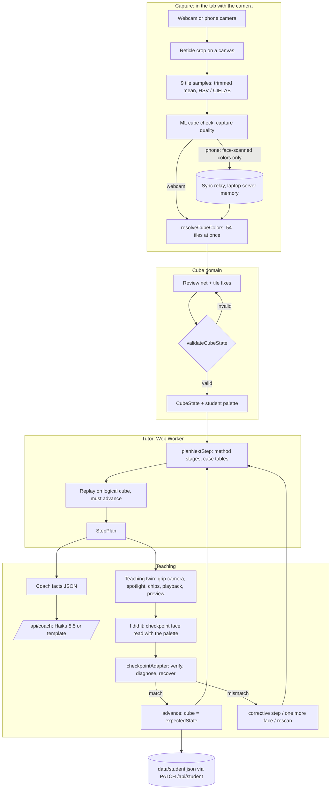

# System Architecture

**Product**: Cubyntra  
**Organization**: Necookie Labs  
**Document Version**: 2.0  
**Status**: Tutor rebuild (2.0.0)  
**Last Updated**: 2026-11-17  

---

## 1. Architectural Philosophy & Principles

Cubyntra is a local, single-student cube tutor. Its architecture follows six tenets:
1. **Mathematical ground truth over graphics**: the logical `CubeState` is the truth. The
   Three.js twin only draws it.
2. **The engine picks every move**: the deterministic tutor engine plans each step and replays it
   on the logical cube before it is shown; Claude only explains (ADR-012, ADR-014).
3. **No pixels leave the capturing device**: frames are sampled to tile colors in the tab that
   holds the camera; the phone and laptop exchange states only (ADR-001, ADR-015).
4. **Pure cores**: `src/cube`, `src/tutor` and `src/learn` have no DOM, React, Three.js or network
   imports and are tested directly.
5. **Drift-free twin**: every layer turn snaps cubie positions and orientations back to integers.
6. **Local by design**: one laptop server holds the profile file, the coach key and the sync
   relay; nothing is hosted.

---

## 2. End-to-End Architecture



The Kociemba solver (`src/solver/solver.ts`) still validates and solves each confirmed scan in
the worker, but no tutor step comes from it.

---

## 3. Module Boundaries & Dependency Direction

```
src/
├── cube/          (pure domain: moves, grip, pieces, orientation, validation; no imports outside)
├── tutor/         (deterministic tutor engine: methods, case tables, step plans, checkpoint,
│                   diagnosis, recovery)
├── learn/         (trainer sets, drills, Leitner, mastery, streaks, timer rules; pure)
├── vision/        (camera, sampling, color, ML cube check, capture quality, palette, checkpoint read)
├── solver/        (Kociemba two-phase solver and the Web Worker that runs solver and tutor jobs)
├── twin/          (step plans mapped onto the 3D twin)
├── three/         (Three.js engine: voxel cubies, snapping, arrows, spotlight, ghost, playback)
├── coach/         (Claude coach: facts, templates, guardrail, spend; useCoach hook)
├── sync/          (pairing, session relay, state messages, tutor and playback mirroring)
├── app-shell/     (shell glue: app token, checkpoint adapter, navigation map, wake lock, install)
├── lib/           (tokens, theme, data dir, app secret, body cap, student profile schema, file, ops)
├── stores/        (Zustand: useCubyntraStore for the scan, useTutorStore for the guided solve)
├── components/    (React presentation: ui/, shell/, home/, scan/, solve/, trainer/, timer/ ...)
└── app/           (Next.js routes: (app)/ screens incl. companion/, api/, manifest.ts)
```

### Dependency Direction Rules:
- `src/cube/` imports nothing outside itself.
- `src/tutor/` depends only on `src/cube/`. It never imports the DOM, Three.js, React, the solver
  or the network (ADR-012; checked by `tests/tutor-api.test.ts`).
- `src/learn/` depends on `src/cube/` and `src/tutor/` only.
- `src/vision/` depends only on `src/cube/` for types (`Face`, `CubeColor`, `ScannedFace`). It
  has no Three.js imports.
- `src/solver/` depends on `src/cube/` and `src/tutor/` (the worker runs tutor jobs).
- `src/twin/` depends on `src/cube/`, `src/tutor/` types and the engine's teaching API as a
  type; it has no DOM, React or Three.js imports.
- `src/three/` depends on `src/cube/` and `src/lib/` (tokens). It receives states and animates them.
- `src/coach/` depends on `src/cube/`, `src/tutor/` and `src/lib/`; its server half
  (`service.ts`, `spend.ts`) runs only in route handlers.
- `src/stores/` orchestrates `cube`, `vision`, `solver`, `tutor` and `learn`. `useCubyntraStore`
  owns the scan; `useTutorStore` owns the guided solve (plan, checkpoint outcome, attempts) and
  the student profile, and reads the scan store only through its public state and actions.
- `src/app-shell/` holds the shell's non-visual pieces. `checkpointAdapter.ts` is the only place
  the app calls checkpoint verification, mistake diagnosis and recovery (see §8).
- `src/components/` connects UI events to `src/stores/`.

---

## 4. Computer Vision Isolation
The Computer Vision module is strictly decoupled from the UI rendering cycle:
- Video frames are captured and processed via a direct `requestAnimationFrame` loop on an offscreen canvas.
- Component state is only updated when classifications or stability values change, preventing high-frequency React re-renders.
- In headless testing or environments without a camera, `src/vision/mock.ts` provides synthetic scan fixtures that inject valid scramble states directly into the domain model.

---

## 5. Solver Isolation & Verification
The solver module (`src/solver/`) is encapsulated behind a clean contract:

```ts
export async function solveCube(state: CubeState): Promise<SolveResult>;
```

Before passing a state into the Kociemba two-phase search, `solveCube` runs `validateCubeState(state)`. After Kociemba returns a candidate sequence, `solveCube` simulates applying the moves on an internal deep-cloned `CubeState` using `applyMoves(state, moves)`. Only if `isCubeSolved(simulatedState) === true` does it return success. The state is turned to standard orientation first and the solution is translated back into the frame the cube is held in. The app calls it through the worker client (`solveInWorker`, `src/solver/client.ts`), which falls back to the main thread when a worker is unavailable.

---

## 6. Zero Floating-Point Drift Engine
In standard 3D engines, repeatedly applying Euler angles or quaternions leads to accumulated floating-point inaccuracies ($\sin(\theta), \cos(\theta)$ rounding errors), resulting in misaligned stickers after 20–30 turns.

Cubyntra eliminates drift completely:
1. **Grouping**: During animation, the turning cubies (9 for a face or slice, 18 for a wide move, 27 for a rotation) are attached to a temporary `pivotGroup` inside the cube group.
2. **Animation**: Easing rotates the pivot around the move axis.
3. **Detachment**: Upon completion, cubies are detached back to `rootCubeGroup`.
4. **Integer Snapping**: World coordinates are rounded to exact integers ($x, y, z \in \{-1, 0, 1\}$).
5. **Orthogonal Angle Snapping**: Quaternions are snapped to multiples of $\pi / 2$.
6. **State Resynchronization**: Cubie sticker colors are refreshed directly from the logical `CubeState`.

Result: no accumulated drift; `tests/three-motion.test.ts` and `three-playback.test.ts` check exact snapping after queued scrambles and that the twin matches the logical state after every playback step.

---

## 7. Future Hardware Extension Points
Moves are plain data (`src/cube/types.ts`), independent of how they are carried out:

```ts
type Move = (
  | { kind: 'face'; face: Face }
  | { kind: 'wide'; face: Face }
  | { kind: 'slice'; slice: 'M' | 'E' | 'S' }
  | { kind: 'rotation'; axis: 'x' | 'y' | 'z' }
) & { quarterTurns: 1 | -1 | 2; notation: string; description: string };
```

Today two consumers exist: the Three.js engine animates them and the UI names them for the
student (`moveName`). A hardware executor would be a third consumer of the same arrays; nothing
of it is built. See [FUTURE_HARDWARE.md](FUTURE_HARDWARE.md) (concept only, out of scope).

---

## 8. App Shell

- **Routes.** `src/app/(app)/` holds the tutor screens (`/`, `/scan`, `/solve`, `/trainer`,
  `/timer`, `/progress`, `/pair`, `/settings`) under one layout, `AppShell`. Each `page.tsx` is a
  server component that sets the title and renders one client view from `src/components/`.
  `/companion` (the phone page) is in the group too, full screen without navigation.
  `app/manifest.ts` serves `/manifest.webmanifest`;
  `app/appMetadata.ts` holds the document metadata and viewport (theme colors, Apple web-app).
- **Session bootstrap.** `useStudentSession` (run by the shell) fetches the app token
  (`/api/auth/token` on the laptop; on a paired phone the token from its sessionStorage pairing,
  `cubyntra.pairing`, ADR-015), loads the profile from
  `/api/student`, starts catching the install prompt and applies the reduce-motion setting.
- **Student profile.** `src/lib/studentProfile.ts` (schema, validation, defaults; no Node or DOM)
  and `src/lib/studentFile.ts` (server: atomic read/write of `data/student.json`).
  `useTutorStore` turns every change into an operation (`src/lib/profileOps.ts`), applies it
  locally and queues it; the queue goes out as `PATCH /api/student` once the profile has loaded,
  and the server merges it into the saved profile under a per-process lock. Without a token
  everything works for the visit and is marked unsaved; the queued changes are merged once a
  token arrives and the profile loads.
- **Checkpoint adapter.** `src/app-shell/checkpointAdapter.ts` is the only caller of
  `verifyCheckpoint`, `diagnoseMistake`, `decideRecovery` and `replanFromScan` (ADR-013). A
  confident diagnosis resumes with a corrective step or a fresh plan; otherwise the student shows
  one more face or rescans, and a mid-solve rescan re-plans with the same method and grip.
- **Pairing.** `AppShell` holds the one `CompanionSyncProvider`, so a pairing made on `/pair`
  survives navigation. `/companion` (the phone) sits in the shell without navigation. On
  `/solve`, `useTutorSync` mirrors the step, grip and twin playback to the phone and applies the
  phone's playback commands, grip and checkpoint verdicts (ADR-015: states only).
- **Planning.** Steps are planned in the worker (`tutor.plan`); if the worker itself fails the
  store plans once on the main thread; a `TutorPlanError` becomes the "scan again" error state.
