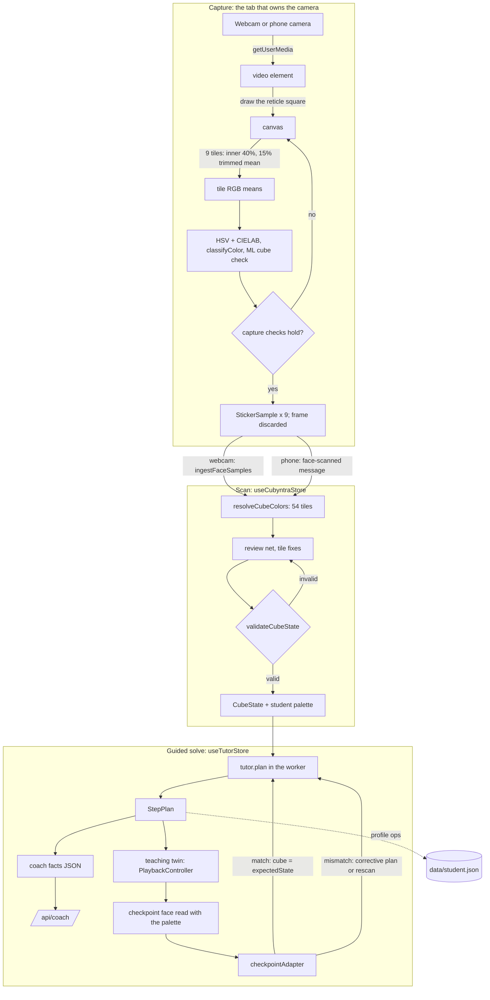
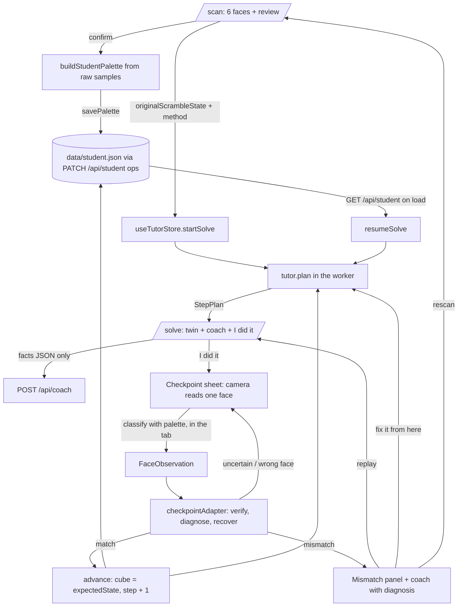

# Cubyntra Data Flow Architecture

**Product**: Cubyntra  
**Organization**: Necookie Labs  
**Status**: Implemented (2.0.0)  
**Scope**: End-to-End System Data Lifecycle

---

## 1. System-Wide Data Flow



---

## 2. Computer Vision Data Flow

1. **Frame capture**: the reticle square is mapped into camera pixels (`mapElementRectToVideo`,
   or, on the webcam scanner, the centered `calculateROIBounds` square, 65% of the shorter side) and drawn into a canvas
   on every `requestAnimationFrame` tick.
2. **Tile sampling** (`sampleGridFromContext`): the square is split 3×3; the inner 40% of each
   cell is read and averaged with a 15% trimmed mean per channel to drop glare and borders.
3. **Classification** (`classifyColor`): CIELAB ΔE to reference colors (or calibrated centers)
   plus HSV rules and dataset gamut gating; the ML detector rejects frames that are not a cube.
4. **Stability / capture**: the webcam scanner locks a face after 8 consecutive matching frames
   (`TemporalStabilityBuffer`); the phone shoots once every capture check has held for 600 ms.
5. **Resolution** (`resolveCubeColors`): the six centers calibrate the palette, an assignment
   enforces nine tiles per color, and quarter-turned faces are repaired.
6. **Checkpoint read** (`readFaceFromContext`, `classifyFaceWithPalette`): one face, classified
   with the student's palette after a per-photo lighting correction; glare tiles count as not seen.

Pixels stop at step 2: from there on only tile means and colors exist. Details in
[COMPUTER_VISION.md](COMPUTER_VISION.md).

---

## 3. State Validation Flow

`validateCubeState` (`src/cube/validator.ts`) first normalizes the orientation, then checks:

```
Resolved 54 tiles
     │
     ▼
[ 1. Counts and centers ] ── fail ──► review (nine of each color, six distinct centers)
     │
     ▼
[ 2. Piece integrity ] ── fail ──► review (no impossible edge or corner colorings)
     │
     ▼
[ 3. Orientation parity ] ── fail ──► review (edge flips ≡ 0 mod 2, corner twists ≡ 0 mod 3)
     │
     ▼
[ 4. Permutation parity ] ── fail ──► review (corner and edge parities equal)
     │
     ▼
Valid CubeState → palette saved → guided solve starts
```

---

## 4. State Management & 3D Synchronization

- **Scan store** (`src/stores/useCubyntraStore.ts`): `startScanning` / `startCompanionScan`,
  `ingestFaceSamples(face, samples)`, `setReviewSticker`, `confirmReview` (valid cube only; it
  also solves the cube with Kociemba in the worker). `originalScrambleState` is what the tutor
  starts from.
- **Tutor store** (`src/stores/useTutorStore.ts`): `startSolve(state, method)` → `loadPlan`
  (worker) → `beginCheckpoint` → `submitObservation` → `advance` / `replayStep` /
  `continueFromDiagnosis` / `replanFromRescan`. Every change to the profile is a `ProfileOp`.
- **Twin**: `TeachingTwin` loads each plan into a `PlaybackController` (`src/three/playback.ts`),
  which computes the state after each move (`statesAlong`) and asks the engine to animate each
  turn to that exact target state. The engine groups the turning cubies under a pivot, rotates,
  re-parents and snaps positions and orientations to integers, then repaints from the logical
  state. Spotlight, slot outline, arrows and the "after" preview follow the playback index
  (`src/twin/teaching.ts`).

---

## 5. Phone-to-Laptop Scan Flow ([ADR-015](ADR/015-state-only-sync.md))

```mermaid
sequenceDiagram
    participant P as Phone (/companion)
    participant S as Sync relay (laptop server memory)
    participant D as Laptop (browser)

    D->>D: GET /api/auth/token (loopback only)
    D->>S: POST /api/session (app token) -> id, 128-bit secret, typed code
    D->>D: QR = /companion#s=id&k=secret&t=appToken (+ the code to type)
    P->>P: fragment -> sessionStorage, address bar stripped
    P->>S: GET /events?role=mobile (secret header)
    loop each of 6 faces
        P->>P: live checks: framing, right face, light, glare, steady
        P->>P: read the crop: sample 9 tiles, ML cube check, center check; pixels discarded
        P->>S: POST /messages face-scanned { 9 colors, 9 confidences, 9 tile means }
        S-->>D: message (seq n)
    end
    D->>D: resolve 54 tiles: center calibration, 9-per-color assignment, orientation repair
    D->>D: review net: student checks flagged tiles against the cube in hand
    D->>S: scan-control confirmed
    D->>D: /solve: tutor plans the step in the worker
    D->>S: step (method, stepIndex, planId, algorithm), cube-state, grip
    S-->>P: phone step card: move chips, next move in words, playback, "Solve on this phone"
    P->>S: playback play / pause / seek (either device, last writer wins by seq)
    D->>S: checkpoint-result after each check (a solve on the phone sends its own)
```

- No photo leaves the phone. The relay holds only the latest state messages, in memory, until the
  session is deleted or expires.
- Faces may arrive in any order; progress is keyed by face. A reading that arrives during review
  while the student has fixed tiles by hand is held until they choose to use it.
- The review screen can send `scan-control` `rescan` to return the phone to a specific face.

---

## 6. Guided Solve and Profile Flow



- **What is stored.** `data/student.json` (version 2, at most 128 KB, written atomically; a version 1 file is migrated on read): name,
  settings, the palette (mean and spread per color, no images), the solve in progress (method,
  cube state as held, grip, step index, attempts at the current step, the highest hint on the stage), stats
  counters, the highest hint used each time a stage was completed, the days practised, the trainer's
  Leitner boxes per case and the timer history (times, penalties and scrambles; no images).
- **What leaves the tab.** Checkpoint photos never leave the device that took them: frames are
  drawn into a canvas, sampled to 9 RGB values and classified in the tab. Only profile changes
  (small JSON operations) go to `/api/student` and only the compact facts JSON (no images, no cube state) goes to
  `/api/coach`, both with the `x-cubyntra-token` header.
- **Resume.** On every step the solve's current cube and step index are saved. Opening `/solve`
  later loads the profile and plans the next step from the saved cube.
- **Two devices.** The laptop and a paired phone (or two tabs) each send only their changes
  (`PATCH /api/student`, `src/lib/profileOps.ts`); the server merges them one request at a time.
  Timer solves merge by id, trainer answers and stat counts add up, and the saved solve only moves
  forward (a newer solve, a later step, or a later save of the same step), so neither device can
  wipe or roll back the other's progress.

