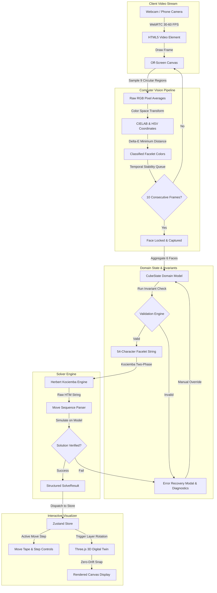
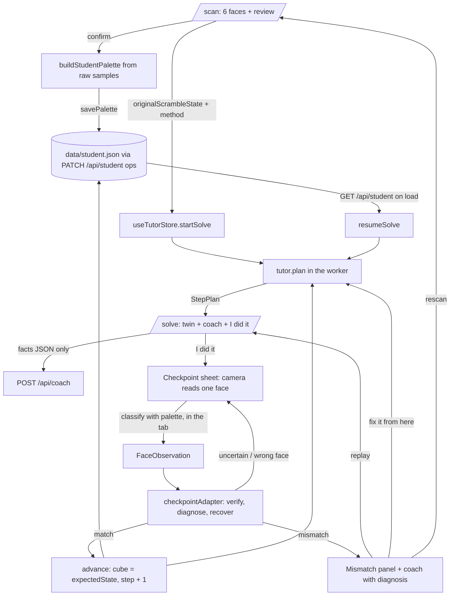

# Cubyntra Data Flow Architecture

**Product**: Cubyntra  
**Organization**: Necookie Labs  
**Status**: Implemented  
**Scope**: End-to-End System Data Lifecycle

---

## 1. System-Wide Data Flow Pipeline



---

## 2. Computer Vision Data Flow

1. **Frame Capture**: Off-screen `HTMLCanvasElement` renders current video frame every `requestAnimationFrame` tick.
2. **Normalized Grid Sampling**: 9 coordinates $(u_i, v_j) \in [0, 1] \times [0, 1]$ mapped to canvas pixel dimensions. Circular kernel radius $R = 8\text{px}$ averages interior pixels to eliminate sensor noise.
3. **Perceptual Classification**:
   $$E_{\text{distance}} = \sqrt{(L_1 - L_2)^2 + (a_1 - a_2)^2 + (b_1 - b_2)^2}$$
   Reference swatches are calibrated to standard competition cube shades.
4. **Temporal Stability Queue**: A sliding window of size $N = 10$. If all 9 sample cells yield identical classifications across $N$ consecutive frames, the face state transitions from `UNSTABLE` to `LOCKED`.

---

## 3. Mathematical State Validation Flow

The 6-face data structure undergoes four sequential verification filters:

```
Raw Face Captures [U, D, F, B, L, R]
               │
               ▼
[ 1. Cardinality Filter ] ── Fail ──► Reject (Sticker count != 9 per color)
               │ Pass
               ▼
[ 2. Physical Piece Integrity ] ── Fail ──► Reject (Impossible edge/corner pairs)
               │ Pass
               ▼
[ 3. Permutation Parity ] ── Fail ──► Reject (Odd edge/corner swap parity)
               │ Pass
               ▼
[ 4. Group Orientation Parity ] ── Fail ──► Reject (Edge flip != 0 mod 2, Twist != 0 mod 3)
               │ Pass
               ▼
Output Validated 54-Facelet String
```

---

## 4. State Management & 3D Synchronization

The centralized Zustand store (`src/stores/useCubyntraStore.ts`) broadcasts state updates to both DOM components and the Three.js rendering loop:

- **State Dispatches**:
  - `captureFace(face, grid)`: Advances scanner step, updates face cache.
  - `solveCurrentState()`: Invokes solver, stores move array, resets playback counter to 0.
  - `nextStep()` / `prevStep()`: Updates `currentStepIndex`, triggering Three.js layer animations.
- **Three.js Synchronization**:
  - The 3D engine subscribes to `currentStepIndex`.
  - When the index increments, the engine isolates the target slice, attaches cubies to the pivot group, interpolates rotation by $90^\circ$ or $180^\circ$, reparents to scene, and snaps transforms to exact integer coordinates.
  - Directional 3D arrows update position and rotation sense immediately.

---

## 5. Phone-to-Laptop Scan Flow ([ADR-015](ADR/015-state-only-sync.md))

```mermaid
sequenceDiagram
    participant P as Phone (/companion)
    participant S as Sync relay (laptop server memory)
    participant D as Laptop (browser)

    D->>D: GET /api/auth/token (loopback only)
    D->>S: POST /api/session (app token) -> id, 128-bit secret, typed code
    D->>D: QR = /companion#s=id&k=secret&t=appToken (+ the code to type)
    P->>P: fragment -> sessionStorage, address bar stripped
    P->>S: GET /events?role=mobile (secret header)
    loop each of 6 faces
        P->>P: live checks: framing, right face, light, glare, steady
        P->>P: read the crop: sample 9 tiles, ML cube check, center check; pixels discarded
        P->>S: POST /messages face-scanned { 9 colors, 9 confidences, 9 tile means }
        S-->>D: message (seq n)
    end
    D->>D: resolve 54 tiles: center calibration, 9-per-color assignment, orientation repair
    D->>D: review net: student checks flagged tiles against the cube in hand
    D->>S: scan-control confirmed, cube-state, step (solution)
    S-->>P: "Solving on your computer" + remote controls
    P->>S: playback play / pause / seek (either device, last writer wins by seq)
    D->>D: Kociemba solve, animated playback on the 3D twin
```

- No photo leaves the phone. The relay holds only the latest state messages, in memory, until the
  session is deleted or expires.
- Faces may arrive in any order; progress is keyed by face. A reading that arrives during review
  while the student has fixed tiles by hand is held until they choose to use it.
- The review screen can send `scan-control` `rescan` to return the phone to a specific face.

---

## 6. Guided Solve and Profile Flow (Phase 7)



- **What is stored.** `data/student.json` (version 2, at most 128 KB, written atomically; a version 1 file is migrated on read): name,
  settings, the palette (mean and spread per color, no images), the solve in progress (method,
  cube state as held, grip, step index, attempts at the current step, the highest hint on the stage), stats
  counters, the highest hint used each time a stage was completed, the days practised, the trainer's
  Leitner boxes per case and the timer history (times, penalties and scrambles; no images).
- **What leaves the tab.** Checkpoint photos never leave the device that took them: frames are
  drawn into a canvas, sampled to 9 RGB values and classified in the tab. Only profile changes
  (small JSON operations) go to `/api/student` and only the compact facts JSON (no images, no cube state) goes to
  `/api/coach`, both with the `x-cubyntra-token` header.
- **Resume.** On every step the solve's current cube and step index are saved. Opening `/solve`
  later loads the profile and plans the next step from the saved cube.
- **Two devices.** The laptop and a paired phone (or two tabs) each send only their changes
  (`PATCH /api/student`, `src/lib/profileOps.ts`); the server merges them one request at a time.
  Timer solves merge by id, trainer answers and stat counts add up, and the saved solve only moves
  forward (a newer solve, a later step, or a later save of the same step), so neither device can
  wipe or roll back the other's progress.

