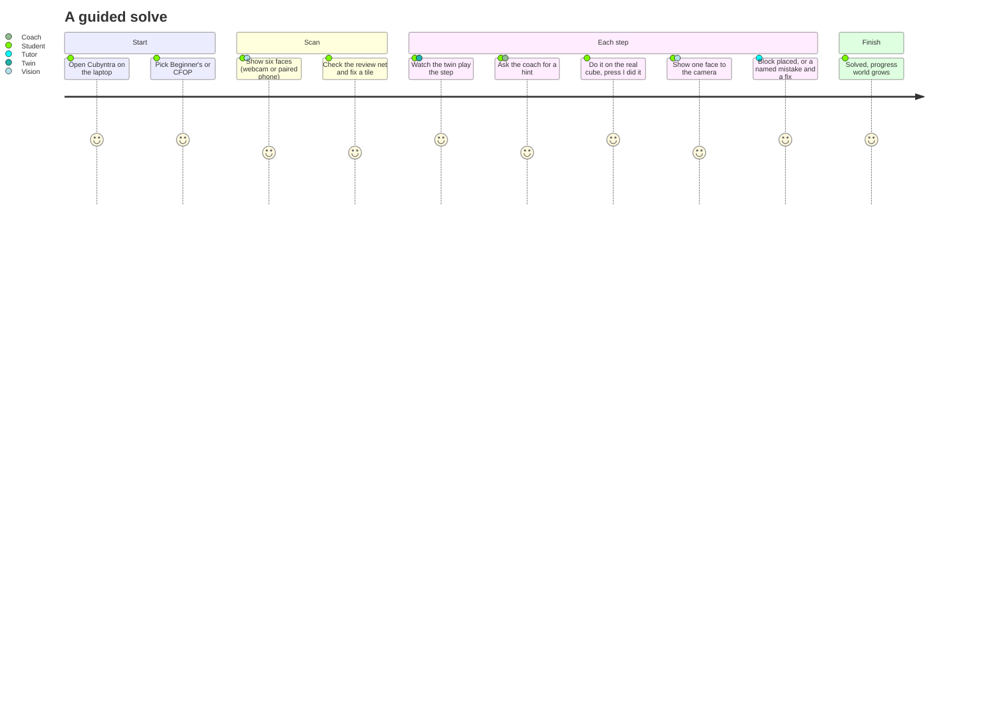

# Product Requirements Document (PRD)

**Product**: Cubyntra  
**Organization**: Necookie Labs  
**Tagline**: *See it. Solve it.*  
**Document Version**: 2.0  
**Status**: Tutor rebuild (2.0.0)  
**Last Updated**: 2026-11-17  

---

## 1. Product Overview
**Cubyntra** is a local, single-student Rubik's Cube tutor. It runs as a PWA from a Next.js 16
server on the student's laptop (`npm run dev`), with a phone on the same Wi-Fi as an optional
camera and remote. The student scans their own cube, a 3D twin shows that exact cube in their
hands and animates each step of either the **beginner's method** or **CFOP**, a coach (Claude)
explains each step in plain language, and **checkpoint scans** confirm the step was done right.

The decisions behind it are fixed in `docs/tutor/GOAL.md`; this document states the product
requirements they imply.

---

## 2. Product Vision
Teach one learner to solve the cube by themselves: first with the beginner's method, then with
CFOP, without ever showing a move the engine has not checked, and without any picture of the
learner's room leaving the device that took it.

---

## 3. Problem Statement
1. **Solvers solve; they do not teach.** A 20-move Kociemba solution is correct but teaches
   nothing a learner can repeat on the next scramble.
2. **Notation is a wall.** `R U R' U'` means little to a 10-year-old; the learner needs to see the
   turn on *their* cube, held the way they hold it, and hear it in words.
3. **Mistakes go unnoticed.** One wrong turn mid-algorithm silently breaks the next five steps.
   Tutorials and videos cannot see the learner's cube.
4. **AI tutors invent moves.** A language model asked "what do I do next" will confidently name
   moves that do not solve anything.
5. **Camera apps leak.** Pointing a camera into a home must not send pictures anywhere.

---

## 4. Target User
- **One student**, ages 10 and up, learning in English, on their own laptop, with or without a
  phone. There are no accounts, teachers or multiple users.
- Progress path: beginner's method → CFOP with the 2-look last layer → full OLL / PLL.

---

## 5. User Needs
- Scan a real cube quickly, and fix a misread tile before anything is planned from it.
- See each step on a twin that matches the cube in hand: same colors, same grip, the pieces that
  matter lit up, the moves as chips and in words.
- Ask for help at the level needed: what to look for, why it works, the exact moves.
- Know whether the step was done right, and if not, what probably went wrong and how to recover.
- Practise algorithms, time solves and see progress grow.
- Use it offline from the coach (no key, or the spend cap reached) without losing any teaching.

---

## 6. Product Goals
1. A guided solve with either method completes through the tutor engine for every scramble
   (tested on 10,000 fixed-seed scrambles per method and variant).
2. Every move shown is chosen by the deterministic engine and replayed on the logical cube first.
3. A checkpoint catches the student's slip and names it (≥ 95% top-diagnosis accuracy on
   injected mistakes; measured 100% of the 1,819 detected on synthetic photos).
4. The coach costs at most $10 a month and falls back to built-in templates without any loss of
   function.
5. No image leaves the device that captured it.
6. Accessible to WCAG 2.2 AA: labels, focus traps, AA contrast, color-blind letters, reduced motion.

---

## 7. Non-Goals
Hosting or deployment, accounts, multiple users, teacher dashboards, native apps, Bluetooth smart
cubes, tracking moves from live video, languages other than English, physical robotics.

---

## 8. Scope (MoSCoW)

### MUST HAVE (2.0, implemented)
- Six-face scan by webcam or paired phone, with a review net and per-tile correction.
- Tutor engine: beginner's method (8 stages) and CFOP (cross, F2L, 2-look OLL/PLL, AUF).
- Teaching twin: grip-framed camera, regrips, spotlight, slot outline, move chips, play / step /
  0.5× / loop, "after" preview.
- Checkpoint scans with the student's palette, mistake diagnosis, corrective steps, rescan and
  re-plan, manual "it matches".
- Claude Haiku 5.5 coach with three hint levels, move guardrail, templates, mock mode and a
  $10/month cap.
- App shell: Home, Scan, Solve, Trainer, Timer, Progress, Pair, Settings; installable manifest;
  wake lock while solving; interrupted solves resume from `data/student.json`.
- State-only phone ↔ laptop sync with QR + typed-code pairing.

### SHOULD HAVE (2.0, implemented)
- Full 57 OLL / 21 PLL as a CFOP setting.
- Algorithm trainer with spaced repetition; timer with WCA inspection and averages; progress
  world with mastery, streaks and graduation suggestions.
- Light / dark / system themes; color-blind sticker letters; "moves in words".

### COULD HAVE (not implemented)
- Service-worker offline caching (needs a certificate the phone trusts; notes in
  `docs/DEVELOPMENT.md` §6.6).
- Voice read-out of steps.

### OUT OF SCOPE
- Everything in §7.

---

## 9. User Stories
- **US-01 (Scan)**: As a student, I want the camera to guide me face by face and show me the net
  before solving, so that a misread tile never becomes a wrong plan.
- **US-02 (Choose)**: As a student, I want to pick the beginner's method or CFOP, so that the
  steps match what I am learning.
- **US-03 (Follow)**: As a student, I want the twin to show my cube in my grip and play the step's
  moves slowly, so that I can copy them.
- **US-04 (Hint)**: As a student, I want to ask what to look for, why it works, or the exact
  moves, so that I learn instead of just copying.
- **US-05 (Check)**: As a student, I want to show the cube after a step and hear whether it is
  right, and what went wrong if not, so that one slip does not ruin the solve.
- **US-06 (Resume)**: As a student, I want an interrupted solve to continue where I left off.
- **US-07 (Practise)**: As a student, I want to drill the cases I keep missing and time my solves.
- **US-08 (Phone)**: As a student, I want to scan and follow on my phone while the laptop shows
  the big twin.

---

## 10. User Journey

---

## 11. Functional Requirements
Detailed and traced in [SRS.md](SRS.md).
- **FR-SCAN**: six-face scan, review net, tile correction, valid cube only.
- **FR-TUTOR**: a step plan per step from the deterministic engine, replayed before it is shown.
- **FR-TWIN**: the twin matches the logical cube after every step; grip, spotlight, chips,
  playback, preview.
- **FR-CHECK**: checkpoint verification, diagnosis and recovery.
- **FR-COACH**: streaming explanations, guardrail, templates, cap, token and rate limit.
- **FR-LEARN**: trainer, timer, progress, graduation.
- **FR-SYNC**: pairing and state-only sync.
- **FR-PROFILE**: local profile, resume, merge of concurrent changes.

---

## 12. Non-Functional Requirements
- **Privacy**: no image leaves the capturing device; the coach receives a facts JSON only.
- **Correctness**: the logical cube is the ground truth; the twin snaps to integer positions.
- **Responsiveness**: planning and solving run in a Web Worker.
- **Accessibility**: WCAG 2.2 AA (see [UI_UX.md](UI_UX.md) §5).
- **Locality**: runs on localhost; no hosting, no accounts.

---

## 13. Acceptance Criteria
The phase gates in `docs/tutor/GOAL.md`, tracked in `docs/tutor/PROGRESS.md`. In summary:
1. Both methods complete every one of 10,000 fixed-seed scrambles, each step advancing.
2. The twin's colors equal `expectedState` after each tutor step plays.
3. The injected mistake is the top diagnosis in ≥ 95% of synthetic checkpoint cases.
4. The coach tests (mocked SDK) cover the request shape, guardrail, cap, template fallback and
   token rejection; the build and tests never call the real API.
5. `npm run lint` (0/0), `typecheck`, `test` and `build` pass.

---

## 14. Risks & Mitigations
| Risk | Severity | Mitigation |
| :--- | :--- | :--- |
| Real cameras, glare and worn stickers read differently from the synthetic tests | High | Per-student palette, "show me again" on low confidence, tile editing, manual "it matches"; by-hand check listed in the morning report |
| The coach names a move outside the step | High | The engine picks every move; a post-check replaces any such reply with the template |
| Coach spend | Medium | Hard monthly cap with worst-case reservation per call; templates afterwards |
| A device on the Wi-Fi joins a pairing | Medium | 128-bit secret, loopback-only app token, single-use typed code with a rate limit |
| Phone does not trust the self-signed certificate | Medium | One-time warning for the camera; optional certificate install for PWA install |

---

## 15. Beyond This Release
See [ROADMAP.md](ROADMAP.md). Physical robotics remains a separate, unbuilt concept
([FUTURE_HARDWARE.md](FUTURE_HARDWARE.md)).
