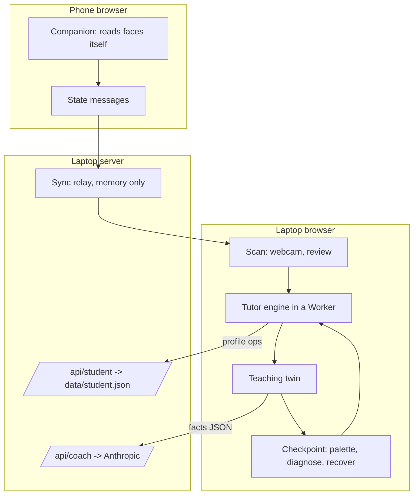

# Software Requirements Specification (SRS)

**Product**: Cubyntra  
**Organization**: Necookie Labs  
**Standard**: Inspired by IEEE Std 830 / ISO/IEC/IEEE 29148  
**Document Version**: 2.0  
**Status**: Tutor rebuild (2.0.0)  
**Last Updated**: 2026-11-17  

---

## 1. Introduction

### 1.1 Purpose
This SRS states the functional and quality requirements of **Cubyntra 2.0**, a local,
single-student Rubik's Cube tutor, and traces each to the module and tests that implement it.
The product decisions are fixed in `docs/tutor/GOAL.md`.

### 1.2 Scope
Scanning a physical cube (webcam or paired phone), a deterministic tutor engine for the
beginner's method and CFOP, a teaching 3D twin, checkpoint scans with mistake diagnosis, a
Claude coach with guardrails and a spend cap, learning features (trainer, timer, progress), a
local student profile and a state-only phone ↔ laptop sync. Hosting, accounts, multiple users,
native apps, smart cubes and robotics are out of scope.

### 1.3 Definitions
- **Step plan**: the engine's output for one step: method, stage, case, grip, setup moves,
  algorithm, pieces to highlight, expected state and checkpoint spec (`src/tutor/types.ts`).
- **Grip**: which color is on top and which faces the student; every instruction is relative to it.
- **Checkpoint spec**: the faces to show and the stickers compared after a step.
- **Palette**: the student's own sticker colors (mean and spread in CIELAB) from the full scan.
- **Coach facts**: the JSON about a step that is the only thing sent to Claude.
- **App token**: the per-install secret in `data/app-secret` required by the coach, profile and
  session-creation routes.
- **HTM**: half-turn metric; the engine reports layer turns (regrips not counted).

---

## 2. Overall Description

### 2.1 Product Perspective
A Next.js 16 app (React 19, Three.js, Zustand) served from the student's laptop. Browser code
does all vision, planning (in a Web Worker) and rendering; the laptop's server process holds the
profile file, the coach's API key and the in-memory sync relay.

### 2.2 Operating Environment
- Laptop: Node.js 20.9+ running `npm run dev` (HTTPS, self-signed) or `npm run build && npm start`.
- Browsers with `getUserMedia`, Canvas 2D, WebGL and Web Workers (current Chrome, Edge, Safari,
  Firefox). The phone camera needs an `https://` page.
- Optional: an Anthropic API key in `.env.local`.

### 2.3 Constraints
- No image or pixel data may leave the device that captured it.
- `src/cube`, `src/tutor` and `src/learn` import no DOM, React or Three.js.
- Claude never chooses moves. No real API calls in the build or tests.
- Raised design only: colors, gradients and shadows from the design tokens, corners from one radius scale, no blur, glass or text shadows (ADR-018).

---

## 3. Specific Requirements

### 3.1 Scanning
- **FR-SCAN-001**: The system shall guide the student through six faces with a reticle and live
  quality checks (framing, right face, light, glare, steady).
- **FR-SCAN-002**: The system shall resolve all 54 tiles together (center calibration,
  nine-per-color assignment, orientation repair) and show a review net with doubtful tiles marked.
- **FR-SCAN-003**: The student shall be able to correct any non-center tile, and planning shall
  start only from a state that passes `validateCubeState`.
- **FR-SCAN-004**: On confirm, the system shall build the student palette from the raw samples
  and save it to the profile.
- **FR-SCAN-005**: Camera tracks shall be stopped when the scanner or checkpoint sheet closes; a
  camera that gives no stream in 30 s or no frame in 10 s shall show the failed state.

### 3.2 Tutor Engine
- **FR-TUTOR-001**: The system shall support the beginner's method (daisy, white cross, white
  corners, flip, middle edges, yellow cross, yellow edges, position and orient yellow corners) and
  CFOP (cross ≤ 8 turns, 41-case F2L, 2-look OLL/PLL or full 57 OLL / 21 PLL, AUF).
- **FR-TUTOR-002**: Every plan shall be replayed on the logical cube before it is returned; a plan
  that does not advance the stage shall throw.
- **FR-TUTOR-003**: Plans shall be made in a Web Worker, with a main-thread fallback.
- **FR-TUTOR-004**: A mid-solve rescan shall re-plan from the observed cube with the same method
  and grip.

### 3.3 Teaching Twin
- **FR-TWIN-001**: The twin shall show the logical state; after each step plays its colors shall
  equal the plan's `expectedState`.
- **FR-TWIN-002**: The camera shall frame the plan's grip and animate regrips.
- **FR-TWIN-003**: The step's pieces shall be at full color and the rest faded; the target slot
  outlined; a faded "after" preview available.
- **FR-TWIN-004**: Controls: play / pause, step back / forward, half speed and loop; move chips
  highlight the current move in sync.
- **FR-TWIN-005**: Every layer turn shall snap cubies to integer positions and right-angle
  orientations; a lost WebGL context shall be rebuilt.

### 3.4 Checkpoints
- **FR-CHECK-001**: After "I did it" the system shall read the checkpoint faces with the
  student's palette and compare only the check-spec stickers, each with a confidence.
- **FR-CHECK-002**: Low confidence shall ask to show the face again; another face shall be
  named as the wrong face.
- **FR-CHECK-003**: On a mismatch the system shall rank the consistent mistakes (wrong direction,
  skipped, doubled, wrong face, wrong grip, stopped early, extra repeat).
- **FR-CHECK-004**: A confident diagnosis shall offer a corrective step; otherwise one more face
  or a full rescan and a fresh plan.
- **FR-CHECK-005**: Tile editing and a manual "it matches" shall always be available.

### 3.5 Coach
- **FR-COACH-001**: `POST /api/coach` shall stream an explanation from `claude-haiku-5-5`
  (effort low, at most 400 tokens) for hint levels 1–3, with a fixed cached system prompt and
  the facts JSON.
- **FR-COACH-002**: A reply naming any move outside the step, a refusal or an error shall be
  replaced by the built-in template.
- **FR-COACH-003**: Without a key the coach shall run in mock mode (templates only).
- **FR-COACH-004**: Spend shall be recorded in `data/coach-usage.json`; at the monthly cap
  (default $10) the coach shall switch to templates and say so.
- **FR-COACH-005**: Only requests with the app token shall be served, at most 30 per minute.

### 3.6 Learning
- **FR-LEARN-001**: Trainer: five sets, drills planned as tutor steps, Got it / Missed it or a
  camera check, Leitner boxes so missed cases return sooner.
- **FR-LEARN-002**: Timer: 20-move scramble, 15 s inspection with +2 from 15 s and DNF from 17 s,
  best single, best and current ao5, current ao12 with WCA trimming, history of 100.
- **FR-LEARN-003**: Progress: a block per mastered stage (3 of the newest 5 completions without a
  level-3 hint), streaks, the algorithm collection, graduation suggestions.

### 3.7 Profile
- **FR-PROF-001**: The profile shall live in `data/student.json` (version 2, ≤ 128 KB, atomic
  writes; version 1 migrated; a damaged file moved aside).
- **FR-PROF-002**: Changes shall be sent as operations (`PATCH /api/student`) and merged on the
  server so concurrent devices do not overwrite each other.
- **FR-PROF-003**: An interrupted solve shall resume from the saved cube and step.

### 3.8 Sync
- **FR-SYNC-001**: Pairing shall use a QR code carrying a session id, a 128-bit secret and the app
  token in the URL fragment, or a six-character single-use code valid 10 minutes.
- **FR-SYNC-002**: Messages shall carry states only (`cube-state`, `face-scanned`, `step`,
  `playback`, `grip`, `checkpoint-result`, `presence`, `scan-control`); no route shall accept or
  return image data.
- **FR-SYNC-003**: Either device shall be able to control playback; grip and verdicts apply only
  to the step they belong to.
- **FR-SYNC-004**: Sessions shall expire (30 min idle, 12 h) and be capped at 8.

### 3.9 Shell
- **FR-UI-001**: Routes `/`, `/scan`, `/solve`, `/trainer`, `/timer`, `/progress`, `/pair`,
  `/settings` and `/companion`; phone tab bar and desktop side nav.
- **FR-UI-002**: Manifest and icons for installation; Screen Wake Lock during a solve.
- **FR-UI-003**: Error states for a denied camera, an offline or capped coach, an unreadable cube
  and a failed plan.

---

## 4. Non-Functional Requirements

### 4.1 Performance
- **NFR-PERF-001**: Planning and solving shall not block the main thread (Web Worker).
- **NFR-PERF-002**: One WebGL context per solve; resources disposed on unmount.

### 4.2 Security & Privacy
- **NFR-PRIV-001**: No image data leaves the capturing device (`tests/sync-privacy.test.ts`).
- **NFR-PRIV-002**: The coach receives only the validated facts JSON; no cube state, name or
  images.
- **NFR-SEC-001**: The API key is read only on the server; request bodies are size-capped while
  streaming; sync routes require the session secret.

### 4.3 Accessibility
- **NFR-A11Y-001**: WCAG 2.2 AA contrast for text and 3:1 for outlines; labels on every control;
  dialogs trap focus and close on Escape; one `h1` and one `main` per screen.
- **NFR-A11Y-002**: Optional color-blind letters on stickers; 44px tap targets on phones;
  `prefers-reduced-motion` and the student's reduce-motion setting stop animation.

### 4.4 Quality
- **NFR-QA-001**: `npm run lint` with 0 errors and 0 warnings, `typecheck`, `test` and `build`
  pass on every phase gate.

---

## 5. Requirements Traceability Matrix

| Requirement | Source | Tests |
| :--- | :--- | :--- |
| FR-SCAN-001..002 | `src/vision/captureQuality.ts`, `faceImageAnalyzer.ts`, `resolveCubeColors.ts`, `src/components/camera/`, `src/components/review/` | `capture-quality`, `face-analyzer`, `resolve-colors`, `review-store`, `app-scan` |
| FR-SCAN-003..004 | `src/cube/validator.ts`, `src/vision/palette.ts`, `src/stores/useCubyntraStore.ts` | `cube`, `vision-palette`, `review-store` |
| FR-SCAN-005 | `src/vision/camera.ts`, `src/components/solve/useCheckpointCamera.ts` | `vision-camera-start` |
| FR-TUTOR-001..002 | `src/tutor/methods/`, `src/tutor/cases/`, `src/tutor/engine.ts` | `tutor-*` (incl. `tutor-scrambles`, `tutor-engine`) |
| FR-TUTOR-003 | `src/solver/solver.worker.ts`, `client.ts`, `handlers.ts` | `tutor-worker`, `solver-worker` |
| FR-TUTOR-004 | `src/tutor/recovery.ts`, `src/app-shell/checkpointAdapter.ts` | `tutor-recovery`, `checkpoint-adapter` |
| FR-TWIN-001..005 | `src/three/`, `src/twin/`, `src/components/twin/` | `three-*`, `twin-*`, `arrows`, `app-solve-twin` |
| FR-CHECK-001..005 | `src/tutor/checkpoint.ts`, `diagnose.ts`, `recovery.ts`, `src/vision/checkpointCapture.ts` | `tutor-checkpoint*`, `tutor-diagnose`, `checkpoint-synthetic`, `app-solve` |
| FR-COACH-001..005 | `src/coach/`, `src/app/api/coach/` | `coach-*` |
| FR-LEARN-001..003 | `src/learn/`, `src/components/trainer/`, `timer/`, `progress/` | `learn-*`, `app-trainer`, `app-timer`, `app-progress` |
| FR-PROF-001..003 | `src/lib/studentProfile.ts`, `studentFile.ts`, `profileOps.ts`, `src/app/api/student/`, `src/stores/useTutorStore.ts` | `student-*`, `tutor-store*` |
| FR-SYNC-001..004 | `src/sync/`, `src/app/api/session/` | `sync-*`, `session-routes`, `paired-phone-routes` |
| FR-UI-001..003 | `src/app/`, `src/components/shell/`, `src/app-shell/` | `app-shell-pages`, `pwa-*`, `wake-lock`, `store-errors` |
| NFR-PRIV-001 | all routes | `sync-privacy` |
| NFR-SEC-001 | `src/lib/readBodyCapped.ts`, `localAuth.ts` | `read-body-capped`, `route-body-cap`, `local-auth` |
| NFR-A11Y-001..002 | `src/app/globals.css`, `src/components/ui/` | `a11y-*`, `design-rules`, `tokens`, `ui-*` |

Test names are files in `tests/` without the `.test.ts(x)` suffix; see [TESTING.md](TESTING.md).
