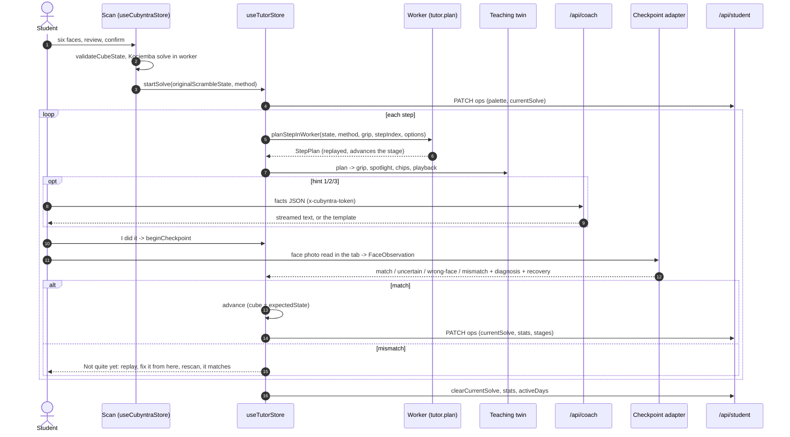
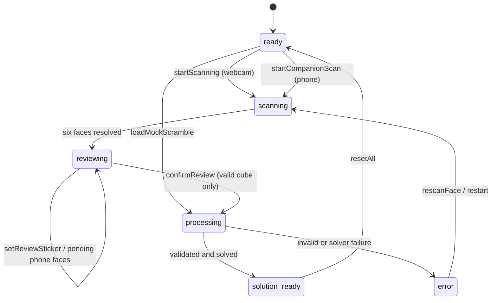
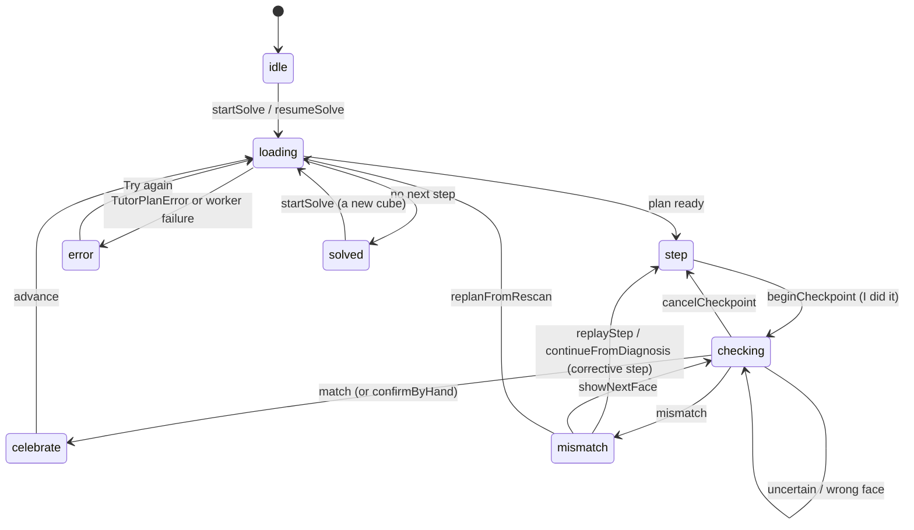

# System Design Document

**Product**: Cubyntra  
**Organization**: Necookie Labs  
**Document Version**: 2.0  
**Status**: Tutor rebuild (2.0.0)  
**Last Updated**: 2026-11-17  

---

## 1. Subsystems & Responsibilities

| Subsystem | Key files | Responsibilities |
| :--- | :--- | :--- |
| **Cube domain** | `src/cube/types.ts`, `transforms.ts`, `grip.ts`, `pieces.ts`, `orientation.ts`, `validator.ts`, `moveNames.ts` | 54-sticker state, face / wide / slice / rotation moves, grips, piece queries, validation, move names. No DOM. |
| **Tutor engine** | `src/tutor/engine.ts`, `methods/`, `cases/`, `checkpoint.ts`, `diagnose.ts`, `recovery.ts`, `api.ts` | Methods as data, step plans replayed and checked, checkpoint verification, mistake diagnosis, recovery. No DOM, React or Three.js. |
| **Learning** | `src/learn/` | Trainer sets and drills, Leitner boxes, mastery and streaks, timer rules and scrambles. Pure. |
| **Vision** | `src/vision/camera.ts`, `sampling.ts`, `color.ts`, `captureQuality.ts`, `faceImageAnalyzer.ts`, `resolveCubeColors.ts`, `palette.ts`, `checkpointCapture.ts`, `ml/` | Camera lifecycle, reticle sampling, color classification, cube presence check, 54-tile resolution, the student palette, reading a checkpoint face. |
| **Worker** | `src/solver/solver.worker.ts`, `client.ts`, `handlers.ts`, `protocol.ts`, `solver.ts` | Kociemba solve of a scan and tutor jobs (`tutor.plan`, `tutor.progress`, `tutor.guidedSolve`) off the main thread. |
| **Twin** | `src/three/engine.ts`, `cubie.ts`, `arrows.ts`, `playback.ts`, `gripCamera.ts`, `spotlight.ts`, `ghost.ts`, `contextLoss.ts`; `src/twin/`; `src/components/twin/` | Voxel cubies, drift-free turns, arrows, grip camera, spotlight and slot outline, "after" preview, playback, context-loss rebuild. |
| **Coach** | `src/coach/` , `src/app/api/coach/` | Facts, system prompt, templates and case notes, guardrail, spend tracking, SSE relay, `useCoach`. |
| **Sync** | `src/sync/`, `src/app/api/session/` | Pairing (QR, typed code), session manager and relay, state messages, tutor and playback mirroring. |
| **Profile** | `src/lib/studentProfile.ts`, `studentFile.ts`, `profileOps.ts`, `src/app/api/student/` | Schema and migration, atomic file, operation merge. |
| **State & shell** | `src/stores/useCubyntraStore.ts`, `useTutorStore.ts`; `src/app-shell/`; `src/components/` | Scan state machine, guided-solve state machine, token bootstrap, checkpoint adapter, screens. |

---

## 2. Guided Solve Sequence



---

## 3. State Machines

### 3.1 Scan (`useCubyntraStore.appState`)



### 3.2 Guided solve (`useTutorStore.phase`)



---

## 4. Data Contracts

### 4.1 Cube (`src/cube/types.ts`)
```ts
type CubeColor = 'white' | 'yellow' | 'green' | 'blue' | 'red' | 'orange';
type Face = 'U' | 'R' | 'F' | 'D' | 'L' | 'B';
type QuarterTurns = 1 | -1 | 2;
type Move =                                   // each also has quarterTurns, notation, description
  | { kind: 'face'; face: Face }
  | { kind: 'wide'; face: Face }
  | { kind: 'slice'; slice: 'M' | 'E' | 'S' }
  | { kind: 'rotation'; axis: 'x' | 'y' | 'z' };
interface CubeState { U: FaceStickers; R: FaceStickers; F: FaceStickers; D: FaceStickers; L: FaceStickers; B: FaceStickers }
interface Grip { top: CubeColor; front: CubeColor }   // src/cube/grip.ts
```

### 4.2 Step plan (`src/tutor/types.ts`)
`StepPlan` carries the method and options, stage and case, `grip` / `gripAfter`, `startState`,
`setupMoves`, `algorithm`, `highlightPieces`, `targetSlot`, `expectedState`, the checkpoint
spec (`facesToShow`, `stickers`), teaching `facts` (goal, look-for, why, repeat) and progress
values. Full definition: [`docs/tutor/METHODS.md`](tutor/METHODS.md) §1.1.

### 4.3 Vision (`src/vision/types.ts`, `palette.ts`)
`StickerSample` (row, col, index, RGB / HSV / LAB, predicted color, confidence, scores),
`FrameClassificationResult`, and `StudentPalette` (mean and spread per color, no images).

### 4.4 Wire formats
Sync messages, coach facts and profile operations: [API_REFERENCE.md](API_REFERENCE.md) §6, §7
and §9.

---

## 5. Concurrency, Performance & Resources

### 5.1 Worker
Kociemba table building, the scan's solve and every tutor job run in one module worker per page
(`getSolverClient`). If the worker cannot load or crashes, the client re-runs waiting jobs on the
main thread; the tutor store plans once on the main thread if the worker itself fails.

### 5.2 Sampling loops
The scanner and checkpoint camera read only the reticle square from a canvas in a
`requestAnimationFrame` loop; React state changes only when a classification or check changes.
Frames are never stored.

### 5.3 Profile writes
The store applies each change locally as a `ProfileOp` and queues it; queued ops go out as one
`PATCH` per batch once a token exists and the profile has loaded. The server merges batches one
at a time under a per-process lock and writes atomically (rename with retries).

### 5.4 WebGL lifecycle
The twin stays mounted across steps, so a solve uses one WebGL context. On unmount the engine
cancels its frame loop, disposes geometries, materials and textures, then calls
`renderer.forceContextLoss()` and `renderer.dispose()`. A lost context is rebuilt on restore.

### 5.5 Camera lifecycle
`initializeCameraStream` times out after 30 s without a stream or 10 s without a frame;
`terminateCameraStream` stops every track when a scanner or checkpoint sheet closes.
